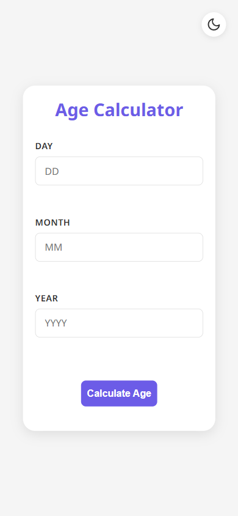

# Age Calculator

Calculates an exact age in years, months and days from a day / month / year input.

**Live demo:** https://codealpha-age-calculator-rho.vercel.app

<div align="center">

| Desktop | Mobile |
|---|---|
|  |  |

</div>

## What it does

Three separate date fields instead of one native date picker, so the input can be masked as it is typed: non-digits are stripped on the fly and day (1–31) and month (1–12) are clamped, which makes an impossible date hard to submit. The result is broken down into years, months and days, plus totals in months, weeks and days. Built during the CodeAlpha front-end internship.

## Tech stack

React 19 · TypeScript · Vite

## Features

- Exact age in years, months and days, not just a year count
- Per-field input masking — non-digits stripped as you type
- Range clamping on day and month inputs
- Dark / light theme toggle with inline SVG icons, persisted to `localStorage`
- Responsive layout set in Noto Sans

## Run locally

```bash
git clone https://github.com/Mister2314/CodeAlpha_Age_Calculator.git
cd CodeAlpha_Age_Calculator
npx serve .
# or just open index.html
```

## What I learned

Masking each field separately forces the validation logic to live in `input` events rather than a single submit check — errors surface while typing instead of after.
