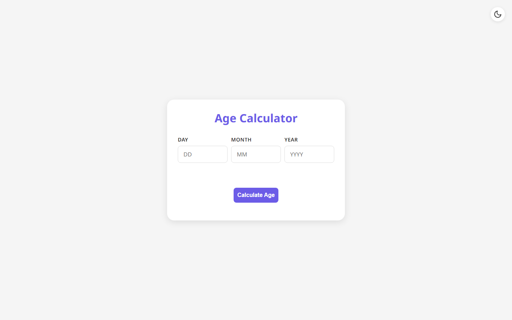
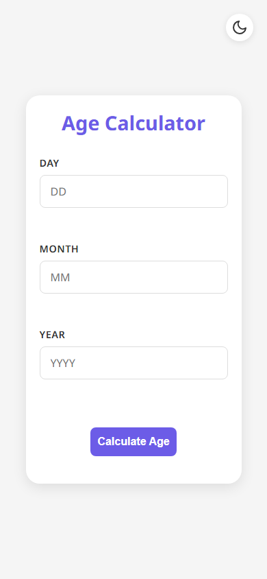

# Age Calculator

**Calculates an exact age in years, months and days, with input masking and a persisted light / dark theme.**

[](https://mister2314.github.io/CodeAlpha_Age_Calculator/)


<p align="center">
  <a href="https://mister2314.github.io/CodeAlpha_Age_Calculator/">
    
  </a>
</p>

## Overview

Enter a date of birth as three separate day / month / year fields and get back an exact age — not just a number of years, but the years, months and days that have passed, plus the total in months, weeks and days.

The three-field layout is deliberate: a single date input hands the browser's own picker the job, whereas separate fields let me mask and validate the input as it is typed. Non-digits are stripped on the fly and out-of-range values are clamped, so an impossible date cannot be submitted.

Built as a front-end task during the CodeAlpha internship programme.

## Features

- Exact age broken down into years, months and days
- Totals in months, weeks and days
- Per-field input masking — non-digits are stripped as you type
- Range clamping for day (1–31) and month (1–12)
- Light / dark theme toggle with inline SVG icons, persisted to `localStorage`
- Responsive layout with the Noto Sans typeface

## Tech Stack

| Layer | Technology |
| --- | --- |
| Markup | HTML5 |
| Styling | CSS3, custom-property themes |
| Logic | Vanilla JavaScript (`DOMContentLoaded`, `localStorage`) |
| Deploy | GitHub Pages |

## Screenshots

| Desktop | Mobile |
| :---: | :---: |
|  |  |

## Getting Started

No build step and no dependencies — clone the repo and open the entry file, or serve the folder locally:

```bash
git clone https://github.com/Mister2314/CodeAlpha_Age_Calculator.git
cd CodeAlpha_Age_Calculator

# Option 1 — open it directly
start index.html      # Windows
open  index.html      # macOS

# Option 2 — serve it locally
npx serve .
```

## Project Structure

```
index.html — date fields, theme toggle and result panel
assets/js/index.js — input masking, validation, date maths, theme persistence
assets/css/style.css — layout and both palettes
```

## Notes

Task completed during the **CodeAlpha** front-end internship programme.

## Author

**Xəyal Hüseynli** — Junior Front-End Developer

[Portfolio](https://hypnosdev.vercel.app) · [GitHub](https://github.com/Mister2314) · [LinkedIn](https://www.linkedin.com/in/x%C9%99yal-h%C3%BCseynli-3487b91ba/) · [xeyalhuseynli06@gmail.com](mailto:xeyalhuseynli06@gmail.com)
